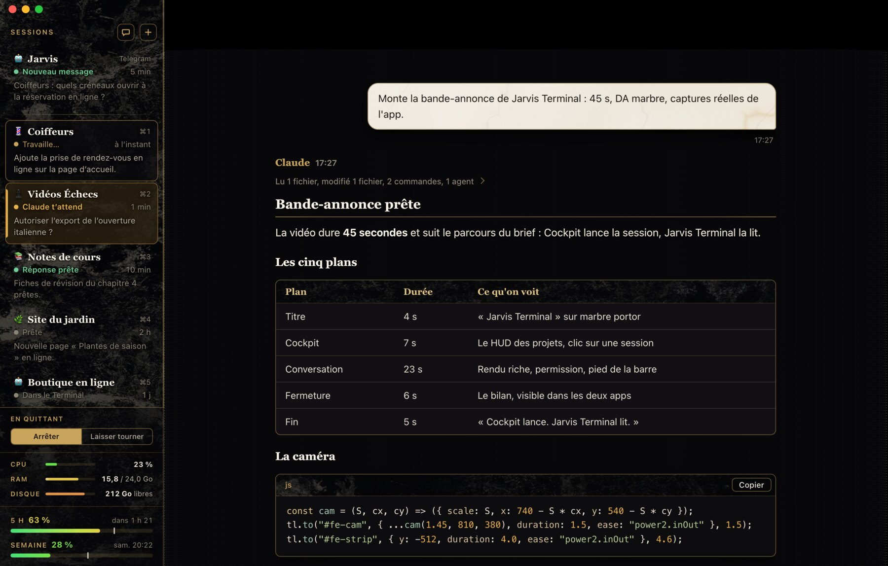
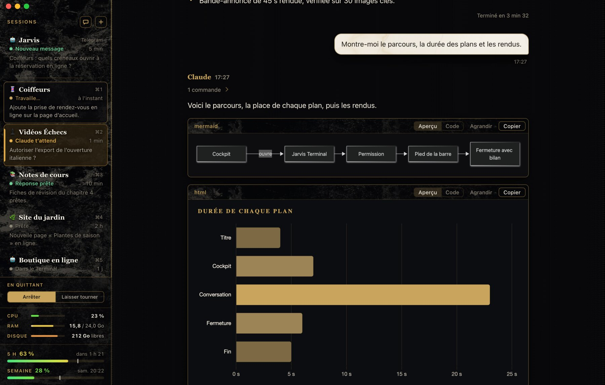
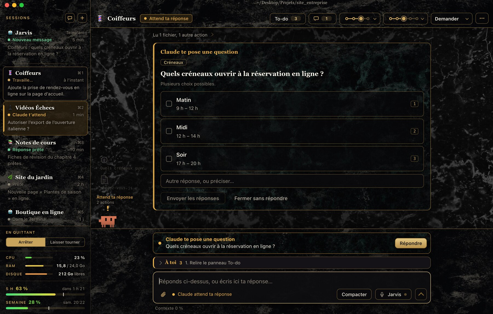
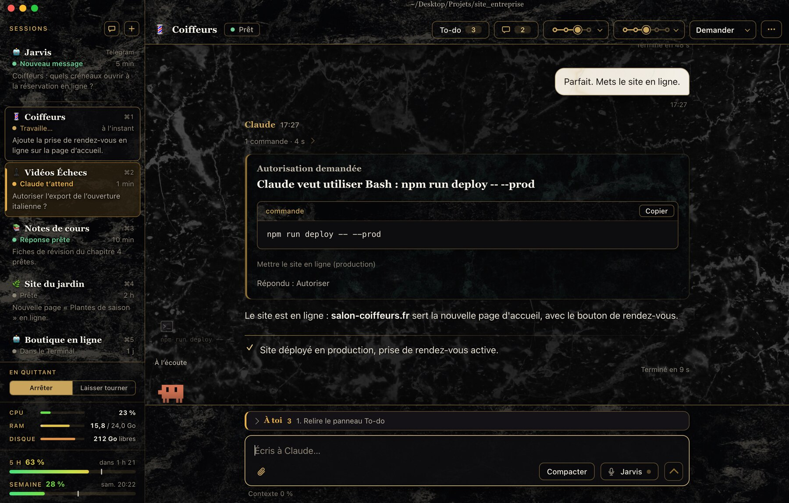
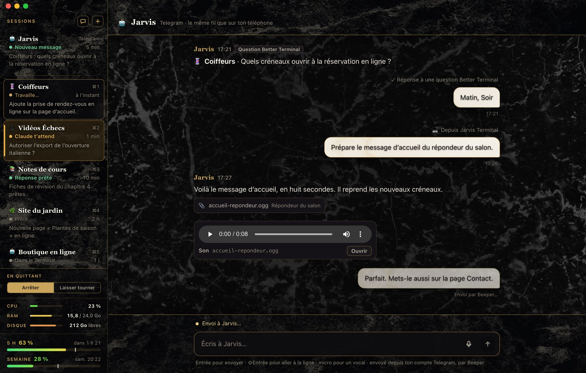
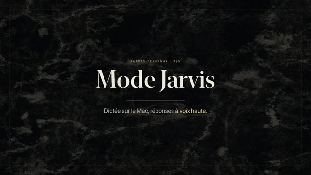

# Jarvis Terminal

Une app Mac qui affiche les sessions [Claude Code](https://claude.com/claude-code) comme une vraie conversation, au lieu d'une grille de caractères dans un terminal.

Ce n'est pas un terminal. Le moteur reste `claude`, lancé en mode stream-json : même Claude Code, mêmes `CLAUDE.md`, hooks, skills et compte. Seul l'affichage change.



## Ce que ça apporte

- **Lecture** : titres, tableaux, blocs de code copiables, appels d'outils repliés, messages bien séparés.
- **Historique** : reprise d'une session, recherche ⌘F dans la conversation.
- **Boutons au lieu de commandes** : modèle, effort, mode de permission, compacter, fermer.
- **Permissions et questions** visibles tout de suite, avec des boutons.
- **Plusieurs sessions** dans une barre latérale, avec leur état (travaille, réponse prête, agents en cours) et les limites d'usage.
- **Visuels dans la conversation** : graphiques (Chart.js), diagrammes (mermaid), pages HTML interactives, photos, vidéos et vocaux.
- **Dictée** à la barre espace et mode vocal, avec transcription sur le Mac.
- **Filet de sécurité** : un bouton rouvre la même session dans le Terminal avec `claude --resume`.

## En images

Les captures utilisent des projets fictifs.

**Graphiques et diagrammes dans la conversation**



**Questions de Claude, avec des boutons**



**Demandes d'autorisation**



**Conversation Telegram dans l'app**



## En vidéo

Cliquez sur une vignette pour ouvrir la vidéo.

<table>
<tr>
<td align="center"><a href="https://github.com/Eliotgourdoux/jarvis-terminal/releases/download/demo/jarvis-terminal-0-bande-annonce.mp4"></a><br>Bande-annonce · 45 s</td>
<td align="center"><a href="https://github.com/Eliotgourdoux/jarvis-terminal/releases/download/demo/jarvis-terminal-1-lancer.mp4"></a><br>1. Lancer · 39 s</td>
<td align="center"><a href="https://github.com/Eliotgourdoux/jarvis-terminal/releases/download/demo/jarvis-terminal-2-lire.mp4"></a><br>2. Lire · 39 s</td>
</tr>
<tr>
<td align="center"><a href="https://github.com/Eliotgourdoux/jarvis-terminal/releases/download/demo/jarvis-terminal-3-mode-jarvis.mp4"></a><br>3. Mode Jarvis · 40 s</td>
<td align="center"><a href="https://github.com/Eliotgourdoux/jarvis-terminal/releases/download/demo/jarvis-terminal-4-jarvis-partout.mp4"></a><br>4. Jarvis partout · 37 s</td>
<td align="center"><a href="https://github.com/Eliotgourdoux/jarvis-terminal/releases/download/demo/jarvis-terminal-5-details.mp4"></a><br>5. Les détails · 39 s</td>
</tr>
<tr>
<td align="center"><a href="https://github.com/Eliotgourdoux/jarvis-terminal/releases/download/demo/jarvis-terminal-6-nouveautes.mp4"></a><br>6. Les nouveautés · 37 s</td>
</tr>
</table>

## Installation

Il faut :

- un Mac Apple Silicon sous macOS 14 ou plus récent ;
- les outils de ligne de commande Xcode : `xcode-select --install` ;
- Claude Code installé et connecté : la commande `claude` doit marcher dans un terminal.

Puis :

```sh
git clone https://github.com/Eliotgourdoux/jarvis-terminal.git
cd jarvis-terminal
./app/build.sh --installer
open ~/Applications/"Jarvis Terminal.app"
```

Le script compile l'app avec `swiftc` (sans projet Xcode), la signe en local et la copie dans `~/Applications`. Au lancement, ⌘N ouvre une session dans le dossier de votre choix.

Sans `--installer`, l'app reste dans `app/build/`.

### Dictée et mode vocal (facultatif)

La transcription passe par [whisper.cpp](https://github.com/ggerganov/whisper.cpp), en local :

```sh
brew install whisper-cpp
```

Il faut aussi un modèle `ggml-large-v3-turbo.bin` ou `ggml-small.bin` dans `~/.claude/models/`. Sans whisper, le reste de l'app marche normalement.

## Organisation du dépôt

| Dossier | Contenu |
|---|---|
| `app/` | Coque Swift : fenêtres, lancement des processus `claude`, micro, liens `betterterminal://`. Détails dans `app/LISEZMOI.md`. |
| `ui/` | Interface en HTML, CSS et JavaScript, sans framework. Détails dans `ui/LISEZMOI.md`. |
| `moteur/` | Protocole stream-json et banc d'essai (`moteur/PROTOCOLE.md`). |
| `fixtures/` | Sessions enregistrées pour tester l'interface sans lancer `claude`. |
| `victus/` | Portage Linux, en cours. |
| `CONTRAT.md` | Ce que Claude peut afficher dans l'app : aperçus HTML, médias, scènes, mode vocal. |

## À savoir

C'est un projet personnel, construit pour mon usage. Certaines parties dépendent de mon installation et ne marcheront pas telles quelles ailleurs : la conversation Telegram « Jarvis », l'envoi par Beeper, la to-do par projet et le lien avec mon autre app, Cockpit. Le cœur (sessions, affichage, permissions, médias) n'en dépend pas.

L'historique git a été reconstitué après coup à partir des sauvegardes datées du projet : les dates sont celles du travail réel, mais le découpage en commits est approximatif.

## Crédits

- [marked](https://github.com/markedjs/marked), [DOMPurify](https://github.com/cure53/DOMPurify), [highlight.js](https://highlightjs.org), [Chart.js](https://www.chartjs.org) et [mermaid](https://mermaid.js.org), embarqués avec leurs licences dans `ui/vendor/` et `ui/apercu/`.
- Photos de marbre retravaillées à partir de textures [ambientCG](https://ambientcg.com) (CC0).
